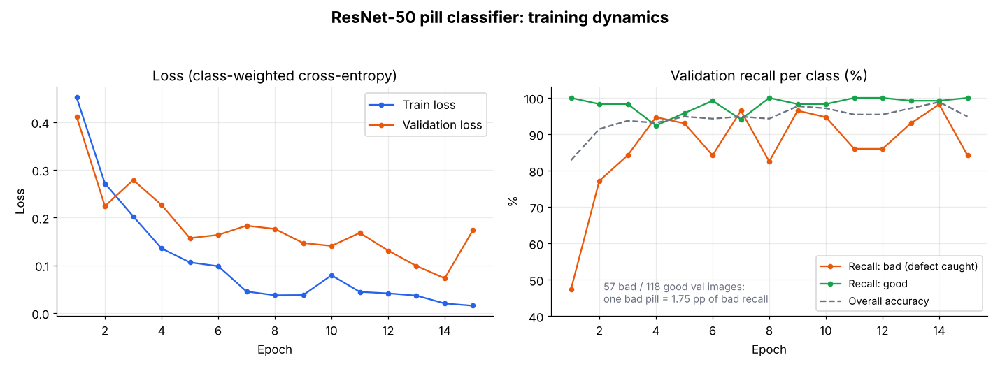
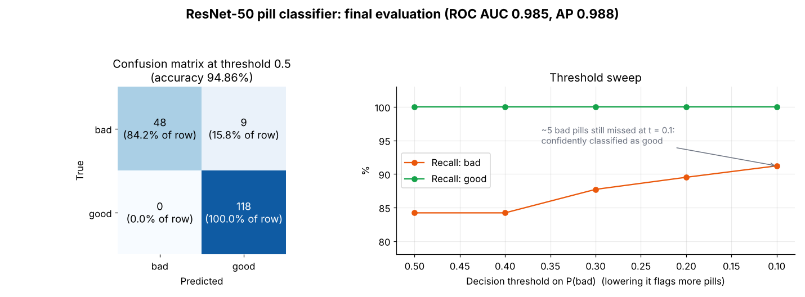

# Pill Defect Classification (ResNet-50, transfer learning)

Binary image classifier that labels pill images as **good** or **bad** (defective), built with PyTorch by fine-tuning an ImageNet-pretrained ResNet-50.

The whole project is a single notebook: [`main_pill_resnet50.ipynb`](main_pill_resnet50.ipynb). Outputs and charts are saved inside it, so it can be read directly on GitHub without running anything.

## Results

Evaluated on a held-out, stratified validation split of 175 images (57 bad, 118 good), using the model after the final epoch (15).

| Metric | Value |
|---|---|
| Accuracy (threshold 0.5) | 94.86% |
| ROC AUC | 0.985 |
| Average precision (bad class) | 0.988 |
| Recall, bad pills (defects caught) | 84.2% (48 of 57) |
| Recall, good pills | 100% (118 of 118) |

Lowering the decision threshold on P(bad) trades nothing on good pills in this split and raises bad recall to 91.2% at a threshold of 0.1.





### Limitations

- The validation set is small: one missed bad pill changes bad recall by 1.75 percentage points. This is why bad recall fluctuates from epoch to epoch (see the right-hand training chart).
- Epoch 14 reached 98.86% accuracy, but the model is not selected by validation score, so the final-epoch numbers above are the ones reported.
- Single split and no separate test set; the threshold sweep was run on the same validation images.
- Even at a threshold of 0.1, about 5 bad pills are still classified as good with high confidence.
- Only the train/validation split is seeded, so rerunning will give somewhat different numbers.

## Method

- **Model:** ResNet-50 with ImageNet weights (`IMAGENET1K_V2`); final layer replaced by a 2048 to 2 linear layer.
- **Data:** 868 images (693 train / 175 validation), stratified 80/20 split with seed 42, resized to 256x256, ImageNet normalization.
- **Augmentation:** random horizontal and vertical flips (applied on the GPU).
- **Imbalance:** the training set has about 2 good images per bad one (468 vs 225), handled with class-weighted cross-entropy (weights 1.54 for bad, 0.74 for good).
- **Optimizer:** Adam, learning rate 1e-4 for pretrained layers and 1e-3 for the new classification layer; batch size 32; 15 epochs.
- **Evaluation:** per-class recall every epoch, then ROC AUC, average precision and a threshold sweep on the final model.

## Dataset

**Source:** _[add the dataset name and link here]_

The notebook expects this layout, relative to the notebook:

```
data/
└── NEU_Defect_Dataset/
    └── pill/
        ├── bad/
        └── good/
```

The dataset is not included in this repository.

## Running it

```bash
git clone https://github.com/tigran0005/pill-classification.git
cd pill-classification
pip install -r requirements.txt
jupyter notebook main_pill_resnet50.ipynb
```

The notebook uses a CUDA GPU if one is available and falls back to CPU otherwise. For GPU training, install the PyTorch build that matches your CUDA version from [pytorch.org](https://pytorch.org/get-started/locally/) before the step above.

Developed with Python 3.10 on an NVIDIA RTX 5070 Ti.
